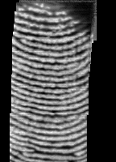

# Varmilo 键盘内置 ELAN 04f3:0c3d 指纹 · Linux 修复

这把 Varmilo 键盘内置的 ELAN 指纹模块（USB `04f3:0c3d`，96×96 传感器）在 Arch / Omarchy 上用 libfprint 默认**录入会因 `Calibration failed!` 中断，或者录入成功但验证永远 `score 0`**。本仓库记录了完整的诊断过程、驱动补丁和可复现的安装/录入脚本。

现在的结果：指纹可以正常录入、验证，已接入 `sudo`、polkit 弹窗和 omarchy-shell 锁屏。**按压**（按住不动约 2 秒）即可，不需要滑动。



---

## 1. 设备

| 项 | 值 |
|---|---|
| USB ID | `04f3:0c3d` `ELAN:Fingerprint`（挂在 Varmilo 键盘内部 hub 后） |
| 传感器 | 96×96，固件 `0x0165` |
| libfprint 驱动 | `elan`（历史悠久的**滑动式**驱动，`dev_class->scan_type = FP_SCAN_TYPE_SWIPE`） |
| 设备表 | `elan.h` 里 `0x0c3d` 原本是 `ELAN_ALL_DEV`（即“90° 旋转后再拼接”） |

## 2. 症状与诊断线索

1. `fprintd` 日志：`Device reported an error during enroll: Calibration failed!`
   - 设备自校准状态永远停在 `0x01`，驱动等 `0x01 → 0x03` 超时后放弃。
2. 校准前的背景图被污染：`calibration mean: 8315, bg mean: 10693, delta: 2378`
   - 拍背景的那一瞬间手指还压在传感器上（按回车/滑动后手没立刻离开）。
3. 拼出来的图帧间横向错位（每帧被旋转 90°，但拼接沿另一个轴估计位移）。
4. 录入 5 个阶段能过，验证却 `score 0/20`，每张图的 minutiae 只有 4–7 个
   - 驱动给每张图打了 `FPI_IMAGE_PARTIAL`，NBIS 会删除**所有贴边特征点**，而滑动条带图几乎全是“边缘”。

## 3. 补丁内容（`patches/libfprint-0c3d.patch`，基于 libfprint 提交 `6f9479c`）

`libfprint/drivers/elan.c`

- `elan_need_calibration()` 恒返回 0：不再请求设备自校准（该设备的自校准是坏的）。
- 校准 SSM 增加背景质量检查：先读设备校准均值，再拍背景；若两者差值 > 400 且重试 < 4 次，延时 800ms 重拍（日志：`background looks contaminated, retrying`）。
- `elan_submit_image()`：不再默认打 `FPI_IMAGE_PARTIAL`（可用 `ELAN_MARK_PARTIAL=1` 恢复），让 NBIS 保留边缘特征点；同时支持 `ELAN_DUMP_DIR` 导出 PGM 便于调试。
- `dev_init()`：`bz3` 匹配阈值 40 → 15（小图特征点少，40 分几乎不可能达到）。

`libfprint/drivers/elan.h`

- `0x0c3d` 的 `driver_data` 改为 `ELAN_NOT_ROTATED`：帧不再旋转后拼接，拼图变成连续条纹。

`libfprint/fpi-print.c`

- 增加调试日志：`print minutiae: N`、`probe minutiae: N`、`template minutiae: N`。

## 4. 构建与安装

依赖：`meson`、`ninja`、`gcc`、`glib2`、`libgusb`、`pixman`、`libusb`（Arch 上 `sudo pacman -S meson ninja base-devel glib2 libgusb pixman libusb`）。

```bash
bash scripts/build-libfprint.sh
```

脚本会：下载 `6f9479c` 源码 → 应用补丁 → 只编译 `elan` 驱动 → 安装到 `/usr/local/lib/fprint-patched` → 通过 `/etc/systemd/system/fprintd.service.d/zz-fprint-patched.conf` 让 fprintd 优先加载它。

> 系统包 `libfprint-git` 不会被修改。代价是以后 `libfprint` 更新不会自动生效，需要重跑本脚本。

## 5. 录入

```bash
bash scripts/enroll.sh press        # 按压（推荐），默认左手食指
bash scripts/enroll.sh swipe        # 滑动，默认右手食指
```

要点：

- 脚本会先倒数 8 秒让手离开，保证背景干净；每次采集前驱动还会自动检查背景是否带残影。
- **按压**：指腹盖满传感器，按住不动约 2 秒，完全抬起；停 5 秒再按。共 6 次。
- **滑动**：滑满整个传感器，匀速约 1.5 秒，滑完立刻抬手；共 6 次。
- 采集后脚本会自动验证（最多 3 次），通过后写入 PAM 配置。

## 6. PAM 配置（脚本自动完成）

- `/etc/pam.d/sudo`、`/etc/pam.d/polkit-1`：
  ```
  auth      [success=1 default=ignore] pam_exec.so quiet /usr/bin/omarchy-hw-laptop-closed
  auth      sufficient pam_fprintd.so
  ```
  （合盖时跳过指纹，直接密码；与 Omarchy 官方一致）
- `/etc/pam.d/omarchy-lock-fingerprint`：omarchy-shell 锁屏检测到该文件且有已录指纹时自动启用指纹解锁。
- `pam_fprintd` 默认允许 3 次重试。

## 7. 排障

```bash
bash scripts/diagnose-sudo.sh       # 开 fprintd 调试并实际跑一次 sudo -v
journalctl -b -u fprintd -o cat | grep -E "background mean|probe minutiae|score"
fprintd-list "$USER"
```

- `probe minutiae` 小于 10 基本必挂：滑动太短或按压没盖满。
- `background mean` 与 `device calib mean` 差 > 400 表示背景带手指残影，重试即可。
- `score 0/15` 对全部模板 = 图与模板没有共同特征点（通常还是采集质量问题）。

## 8. 回滚

```bash
sudo rm -rf /usr/local/lib/fprint-patched /etc/systemd/system/fprintd.service.d/zz-fprint-patched.conf
sudo systemctl daemon-reload && sudo systemctl restart fprintd
# 可选：sudo fprintd-delete "$USER"；并删除 /etc/pam.d/{sudo,polkit-1} 里的两行
```

## 9. 限制

- 这是针对该键盘（该 PID）的本地补丁，不要当作通用驱动改进。
- 96×96 小图 + NBIS 匹配天生偏弱：单次成功率不是 100%，重试 2–3 次基本都能过。
- bz3 阈值 15 降低了误识别的严格度；个人机器可以接受，多人共用设备不建议。
- `ELAN_MARK_PARTIAL`、`ELAN_DUMP_DIR` 是调试开关，默认不要设置。

## 参考

- libfprint：<https://gitlab.freedesktop.org/libfprint/libfprint>（提交 `6f9479c`）
- elan 驱动源码中的自述：96×96 方形传感器“是否能可靠使用尚不确定”
